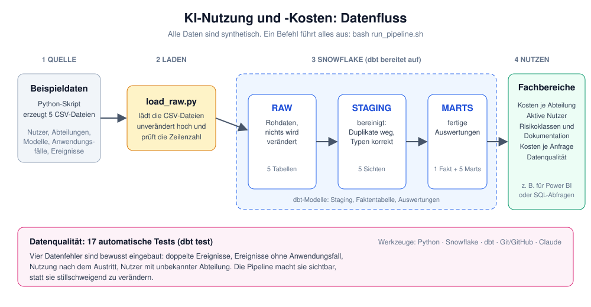

# KI-Nutzung und -Kosten auswerten

Eine Datenpipeline, die zeigt, **was KI im Unternehmen kostet, wer sie nutzt und ob die Anwendungsfälle sauber freigegeben und dokumentiert sind**. Gebaut mit Snowflake, dbt und Python. Alle Daten sind synthetisch (frei erfunden).



## Worum geht es?

Viele Unternehmen setzen KI-Werkzeuge ein, haben aber keinen Überblick: Welche Abteilung verursacht welche Kosten? Wie viele Menschen nutzen die Werkzeuge wirklich? Sind riskante Anwendungen freigegeben und dokumentiert, wie es zum Beispiel der EU AI Act verlangt?

Dieses Projekt beantwortet fünf solcher Fragen mit einer wiederholbaren Pipeline. Es soll zeigen, dass sich eine verständliche, getestete Datenlieferung aufbauen lässt, wenn man die Fachlogik versteht und moderne Werkzeuge nutzt.

## Was liefert das Projekt? (für Fachbereiche)

| Frage | Auswertung (Snowflake, Schema `MARTS`) |
|---|---|
| 1. Was kostet KI pro Abteilung und Monat? | `MART_KOSTEN_JE_ABTEILUNG_MONAT` |
| 2. Wie viele aktive Nutzer gibt es je Monat? | `MART_AKTIVE_NUTZER_MONAT` |
| 3. Welcher Anteil der Anwendungsfälle ist freigegeben und dokumentiert? | `MART_ANWENDUNGSFAELLE_KONFORMITAET` |
| 4. Welche Anwendungsfälle kosten je Anfrage am meisten? | `MART_KOSTEN_JE_ANWENDUNGSFALL` |
| 5. Wo liegen Datenqualitätsprobleme? | `MART_DATENQUALITAET` |

Die Rechenregeln und getroffenen Entscheidungen stehen in [docs/fachfragen.md](docs/fachfragen.md). Beispiele: Fehlgeschlagene Anfragen kosten nichts, und „aktiv“ heißt mindestens eine erfolgreiche Anfrage im Monat.

## So funktioniert es

Die Daten durchlaufen drei Schichten in Snowflake:

1. **RAW:** Die Rohdaten, genau so wie angeliefert. Nichts wird verändert.
2. **STAGING:** Bereinigte Daten. Doppelte Einträge sind entfernt, Zahlen und Datumswerte haben die richtigen Typen.
3. **MARTS:** Die fertigen Auswertungen für die Fachbereiche.

Ein Befehl führt alles aus: Daten erzeugen, laden, aufbereiten, auswerten und prüfen.

## Datenqualität

17 automatische Tests prüfen die Daten (dbt test). Vier Probleme sind **bewusst in die Beispieldaten eingebaut**:

- doppelte Ereignisse
- Ereignisse ohne Zuordnung zu einem Anwendungsfall
- Nutzung nach dem Austritt eines Nutzers
- Nutzer mit unbekannter Abteilung

Die Pipeline macht sie sichtbar (zwei als Test-Warnungen, alle vier in `MART_DATENQUALITAET`), statt sie stillschweigend zu verändern. Fachbereiche sehen so, wo ihre Daten Aufmerksamkeit brauchen.

## Selbst ausprobieren

**Voraussetzungen:** Python (getestet mit 3.12), ein Snowflake-Konto (ein Testkonto genügt) und Git.

```bash
# 1. Repository holen
git clone https://github.com/NEUER-NAME/ki-nutzung-kosten-analytics.git
cd ki-nutzung-kosten-analytics

# 2. Python-Umgebung und Pakete
python -m venv .venv
source .venv/Scripts/activate      # Linux/Mac: source .venv/bin/activate
pip install -r requirements.txt

# 3. Snowflake einmalig vorbereiten:
#    Inhalt von sql/setup_snowflake.sql in Snowflake ausführen

# 4. Zugangsdaten eintragen
cp .env.example .env               # danach .env mit den eigenen Werten füllen

# 5. Alles ausführen
bash run_pipeline.sh
```

Die Zugangsdaten stehen nur in der lokalen Datei `.env`. Sie wird von Git ignoriert und nie hochgeladen.

## Selbst erweitern (für Fachbereiche)

Du möchtest eine eigene Frage beantworten? Die Anleitung [Eigene Auswertung ergänzen](docs/eigene-auswertung-ergaenzen.md) führt in etwa 30 Minuten Schritt für Schritt zu einer sechsten Auswertung, ohne Programmierkenntnisse. Sie zeigt auch, wie man eine KI um Hilfe bittet und warum man ihr Ergebnis trotzdem selbst prüfen muss.

## Projektstruktur

```
├── run_pipeline.sh             # führt die komplette Pipeline aus
├── scripts/
│   ├── generate_data.py        # erzeugt die synthetischen Beispieldaten
│   └── load_raw.py             # lädt die CSV-Dateien nach Snowflake (RAW)
├── sql/
│   └── setup_snowflake.sql     # legt Warehouse, Schemas und Tabellen an
├── dbt/
│   ├── models/staging/         # bereinigte Daten und Tests
│   ├── models/marts/           # Faktentabelle und fünf Auswertungen
│   └── profiles.yml.example    # Vorlage für die Verbindung zu Snowflake
├── docs/
│   ├── fachfragen.md           # Fachfragen und Entscheidungen
│   ├── eigene-auswertung-ergaenzen.md  # Anleitung für Fachbereiche
│   └── architektur.svg         # Architekturbild
└── .env.example                # Vorlage für die Zugangsdaten
```

## Entstehung

Ich habe das Projekt im Dialog mit **Claude** (Anthropic) im Chat gebaut, mit Visual Studio Code, Git und GitHub als Werkzeugen. Claude hat Code und Texte vorgeschlagen. Ich habe die Fachfragen und Entscheidungen bestimmt, jeden Schritt selbst ausgeführt und die Ergebnisse geprüft: Die Pipeline läuft vollständig durch, und die Tests melden die erwarteten Datenfehler.

## Grenzen

- Die Daten sind synthetisch. Die Preise und Modelle sind erfunden und bilden keinen realen Anbieter ab.
- Es gibt bisher keine automatische Terminplanung (zum Beispiel mit Airflow). Die Pipeline wird per Skript gestartet.
- Das Projekt ist als Lern- und Vorzeigeprojekt gedacht, nicht als fertiges Produkt.

## Lizenz

MIT, siehe [LICENSE](LICENSE).
